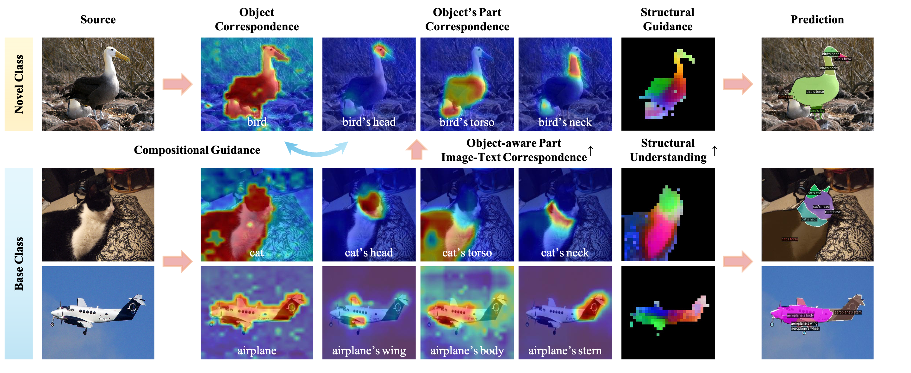
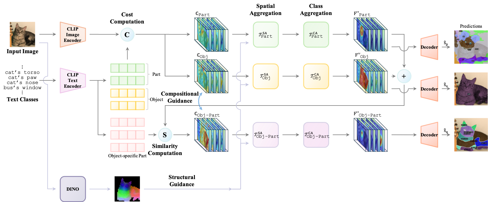

<h2 align="center">
    Fine-Grained Image-Text Correspondence with<br/>
    Cost Aggregation for Open-Vocabulary Part Segmentation
</h2>
<h5 align="center">
    Jiho Choi<sup>1 *</sup>, Seonho Lee<sup>1 *</sup>, Seungho Lee<sup>2</sup>, Minhyun Lee<sup>2</sup>, Hyunjung Shim<sup>1</sup><br>
    (* indicates equal contributions)<br>
    <sup>1</sup>Graduate School of Artificial Intelligence, KAIST, Republic of Korea<br>
    <sup>2</sup>School of Integrated Technology, Yonsei University, Republic of Korea<br>
    <code>{jihochoi, glanceyes, kateshim}@kaist.ac.kr</code>, <code>{seungholee, lmh315}@yonsei.ac.kr</code><br>
</h5>

<h4 align="center">

[](https://arxiv.org/abs/2501.09688)
[](https://cvpr.thecvf.com/virtual/2025/poster/32627)

</h4>

<div align="center">
    <!--  -->
    
    <!--  -->
</div>


</h4>

---


<br/>

### PartCATSeg

PartCATSeg is a novel framework to address the critical challenges of OVPS(Open-Vocabulary Part Segmentation) and significantly improve model performance by leveraging the cost volume.

<div align="center">
    
</div>

<br/>

### Updates

- [x] [2025.04.15] 👨‍💻 The official codes have been released!
- [x] [2025.02.26] 🎉 Our paper has been accepted to [CVPR 2025](https://cvpr.thecvf.com/Conferences/2025)!
- [x] [2025.01.16] 📄 Our paper is now available! You can find the paper [here](https://arxiv.org/abs/2501.09688).


<br/>

### Installation

<!-- TODO: INSTALL.md -->

```sh
# ------------------
#     Init conda
# ------------------
conda create --name partcatseg python=3.8 -y
conda activate partcatseg
pip install --upgrade pip
conda install cuda=12.4.1 -c nvidia -y
pip install torch==2.2.2 torchvision==0.17.2 --index-url https://download.pytorch.org/whl/cu121
pip install timm==0.9.1
pip install scikit-image==0.21.0
pip install scikit-learn==0.24.2
pip install opencv-python==4.5.5.64
pip install hydra-core==1.3.2
pip install openmim==0.3.6
pip install mmsegmentation==0.29.1
pip install tokenizers==0.11.1
pip install Pillow~=9.5
pip install numpy==1.23.0
pip install einops ftfy regex fire ninja psutil gdown

# --------------------------
#     Install Detectron2
# --------------------------
pip install 'git+https://github.com/facebookresearch/detectron2.git'
python -c "import detectron2; print(detectron2.__version__)"  # 0.6

# --------------------------
#     Install mmcv
# --------------------------
# pip install mmcv-full==1.7.1
# => if an error occurs
pip install mmcv-full==1.7.1 -f https://download.openmmlab.com/mmcv/dist/cu110/torch1.7.0/index.html
python -c "import mmcv; print(mmcv.__version__)"  # 1.7.1
```
<br/>

### Prepare Datasets

```sh
cd datasets
```

#### PascalPart116

* You can find further information in the [OV-PARTS](https://github.com/OpenRobotLab/OV_PARTS) GitHub repository.

```sh
gdown https://drive.google.com/uc?id=1QF0BglrcC0teKqx15vP8qJNakGgCWaEH
tar -xzf PascalPart116.tar.gz
find ./PascalPart116/images/val/ -name '._*' -delete
find ./PascalPart116/ -name '._*' -delete
```


#### ADE20KPart234

```sh
gdown https://drive.google.com/uc?id=1EBVPW_tqzBOQ_DC6yLcouyxR7WrctRKi
tar -xzf ADE20KPart234.tar.gz
```

#### PartImageNet (Seg)

* Download the `LOC_synset_mapping.txt` file from [this link](https://www.kaggle.com/c/imagenet-object-localization-challenge/data) and place it in the `datasets` folder.
* Download `PartImageNet_Seg` from [PartImageNet](https://github.com/TACJu/PartImageNet) and extract it into the `datasets` folder as `PartImageNet`.


#### PartImageNet (OOD)

* Download `PartImageNet_OOD` from [PartImageNet](https://github.com/TACJu/PartImageNet) and place it into the `datasets` folder as `PartImageNet_OOD`.


<br/>

### Preprocess Datasets

- PascalPart116
- ADE20KPart234
- PartImageNet (Seg)
- PartImageNet (OOD)

```sh
# PascalPart116
python baselines/data/datasets/mask_cls_collect.py \
    datasets/PascalPart116/annotations_detectron2_part/val \
    datasets/PascalPart116/annotations_detectron2_part/val_part_label_count.json

python baselines/data/datasets/mask_cls_collect.py \
    datasets/PascalPart116/annotations_detectron2_obj/val \
    datasets/PascalPart116/annotations_detectron2_part/val_obj_label_count.json

# ADE20KPart234
# (no preprocessing required)

# PartImageNet (Seg)
cd datasets
python partimagenet_preprocess.py --data_dir PartImageNet
# Make sure to have LOC_synset_mapping.txt in the datasets folder mentioned above.

# PartImageNet (OOD)
# train split
find PartImageNet_OOD/images/train/* -type f -exec mv {} PartImageNet_OOD/images/train/ \;
find PartImageNet_OOD/images/train/* -type d -empty -delete

# val split
find PartImageNet_OOD/images/val/* -type f -exec mv {} PartImageNet_OOD/images/val/ \;
find PartImageNet_OOD/images/val/* -type d -empty -delete
```

<br/>

### Pre-trained Weights

Please first donwload the pre-trained CAT-Seg weight `model_final_base.pth` from the following link to use them in the training.

<table><tbody>
<!-- START TABLE -->
<!-- TABLE HEADER -->
<th valign="bottom">Model</th>
<th valign="bottom">Checkpoint</th>
<tr>
<!-- TABLE BODY -->
<td align="center">CAT-Seg</td>

<td align="center"><a href="https://huggingface.co/hamacojr/CAT-Seg/blob/main/model_final_base.pth">download link</a></td>

</tr>
</tbody></table>


Make sure to place the downloaded weights in the `pretrain_weights` folder.

```bash
mkdir pretrain_weights && cd pretrain_weights
# CAT-Seg
wget https://huggingface.co/hamacojr/CAT-Seg/resolve/main/model_final_base.pth
cd ..
```

<br/>

For the evaluation, we provide the pre-trained weights for the PartCATSeg model on the following datasets:

<table><tbody>
<!-- START TABLE -->
<!-- TABLE HEADER -->
<th valign="bottom">Model</th>
<th valign="bottom">Setting</th>
<th valign="bottom">Dataset</th>
<th valign="bottom">Checkpoint</th>
<!-- TABLE BODY -->
<!-- ROW: per_pixel_baseline_R50_bs16_160k -->
<tr>
    <td align="center">PartCATSeg</td>
    <td align="center">zero-shot</td>
    <td align="center">Pascal-Part-116</td>
    <td align="center"><a href="https://drive.google.com/file/d/1JUJjJQLMKE96H5SLNs4EMm4jiU6fPgRb/view?usp=share_link">model</a></td>
</tr>
<tr>
    <td align="center">PartCATSeg</td>
    <td align="center">zero-shot</td>
    <td align="center">ADE20K-Part-234</td>
    <!-- <td align="center"><i>TBA</i></td> -->
    <td align="center"><a href="https://drive.google.com/file/d/1MKQEk71o9Xvs4aBY_GLyGa1lWTaW10fv/view?usp=share_link">model</a></td>
</tr>
<tr>
    <td align="center">PartCATSeg</td>
    <td align="center">zero-shot</td>
    <td align="center">PartImageNet (Seg)</td>
    <td align="center"><a href="https://drive.google.com/file/d/1zvV6achGzDS_tAwulaSkFYblMTghMHO6/view?usp=share_link">model</a></td>
    <!-- <td align="center"><i>TBA</i></td> -->
</tr>
<!-- <tr>
    <td align="center">PartCATSeg</td>
    <td align="center">zero-shot</td>
    <td align="center">PartImageNet (OOD)</td>
    <td align="center"><i>TBA</i></td>
    <td align="center"><a href="https://drive.google.com/file/d/1XqgHI4CRcfLIz2j8_ZbIvoF_GFjMqCqn/view?usp=drive_link">model</a></td>
</tr> -->

</tbody></table>

```sh
mkdir weights && cd weights

# Pascal-Part-116
# PartCATSeg (partcatseg_voc.pth (928M on Ubuntu / 885M on Google Drive))
gdown https://drive.google.com/uc?id=1JUJjJQLMKE96H5SLNs4EMm4jiU6fPgRb

# ADE20K-Part-234
# PartCATSeg (partcatseg_ade.pth (928M on Ubuntu / 885M on Google Drive))
gdown https://drive.google.com/uc?id=1MKQEk71o9Xvs4aBY_GLyGa1lWTaW10fv

# PartImageNet (Seg)
# PartCATSeg (partcatseg_partimagenet_seg.pth)
gdown https://drive.google.com/uc\?id\=1zvV6achGzDS_tAwulaSkFYblMTghMHO6
```

<br/>

### Usage (Run)

##### Zero-Shot Prediction

```sh
# -------------
#     Train
# -------------
python train_net.py \
    --num-gpus 4 \
    --config-file configs/zero_shot/partcatseg_voc.yaml

# -----------------
#     Inference
# -----------------
python train_net.py \
    --num-gpus 4 \
    --config-file configs/zero_shot/partcatseg_voc.yaml \
    --eval-only MODEL.WEIGHTS ./weights/partcatseg_voc.pth
```

Please note that the performance on `PartImageNet_OOD` should be evaluated by the metric <u>'mIoU-unbase</u>' since the validation set of `PartImageNet_OOD` does not contain the base classes.


<br/>

---

## This fork: tabletop parts (PACO) and GraspClutter6D

This fork adds training on **PACO-LVIS restricted to 39 tabletop objects / 197 object-part classes**
(bottle, box, can, cup, mug, jar, bowl, plate, knife, scissors, drill, ...), and per-object part
segmentation of **GraspClutter6D** scenes using either its ground-truth masks or SAM 3 masks.

### Environment (pixi)

This fork uses [pixi](https://pixi.sh) instead of the conda/pip steps above. The env is locked in
`pixi.toml` / `pixi.lock` (torch 2.2.2 + CUDA 12.1, detectron2 built against it).

```sh
source ./pixi_setup.sh      # keeps pixi's caches inside the repo; source it before every pixi command
pixi install
pixi run fetch-dinov2       # once: pins DINOv2's torch.hub code to the release-era commit
```

- Set `DETECTRON2_DATASETS` in `pixi.toml` (`[activation.env]`) to your datasets root.
- Don't `pip install` into this env. Add packages with `pixi add` / `pixi add --pypi`; a PyPI
  torch would break detectron2's compiled extension.
- `fetch-dinov2` is required because DINOv2's current `main` needs Python >= 3.10.

### Train on PACO tabletop

**1. Download PACO.** This fetches the annotations and only the ~57.6k COCO images PACO uses
(~9 GB), not the full COCO zips. It is resumable: re-run it until it prints `ALL DONE`.

```sh
bash datasets/paco_download.sh $DETECTRON2_DATASETS
```

**2. Convert** to PartCATSeg's object-part format (~30 s, CPU). This writes
`$DETECTRON2_DATASETS/PACO_tabletop/`. The tabletop object list is the `TABLETOP` dict in the
script; to change it, edit the dict and re-run.

```sh
pixi run python datasets/paco_tabletop_preprocess.py \
    --paco-ann  $DETECTRON2_DATASETS/PACO/annotations \
    --coco-root $DETECTRON2_DATASETS/coco \
    --out       $DETECTRON2_DATASETS/PACO_tabletop
```

The output contains absolute paths, so re-run the conversion if you move the data.

**3. Train and test.** Training fine-tunes from `weights/partcatseg_ade.pth` (download it as
described in [Pre-trained Weights](#pre-trained-weights)) and evaluates on PACO val every 1k
iterations. `model_final.pth` is then scored on PACO test.

```sh
bash train_paco.sh                                                        # full run: 20k iterations
OUT=output/paco_smoke bash train_paco.sh SOLVER.MAX_ITER 20 TEST.EVAL_PERIOD 0   # smoke test
```

| | |
|---|---|
| config | `configs/zero_shot/partcatseg_paco_tabletop.yaml` |
| output | `output/partcatseg_paco_tabletop/` (checkpoint every 1k iterations; `log.txt`, `metrics.json`) |
| batch | 1 image x 4 gradient-accumulation steps (`SOLVER.ACCUM_STEPS`), equal to the paper's 4 GPUs x 1 image |
| cost on one RTX 4090 | 16 GB peak, ~1.2 s/step, **~7 h for 20k steps**, plus ~11 min per val pass |

- **Resuming:** re-running `train_paco.sh` resumes from `$OUT/last_checkpoint`.
- **Overrides:** trailing `KEY VALUE` pairs are detectron2 config overrides.
- **Shared GPU:** the script refuses to start while another process holds the GPU; `FORCE=1`
  overrides this.
- **Progress:** follow `tail -f output/partcatseg_paco_tabletop/log.txt`. Training is done when
  `model_final.pth` exists and the PACO test result is printed.
- **Metric:** every class is trained on (there is no zero-shot split), so read `mIoU-base`.

### Part segmentation on GraspClutter6D

PartCATSeg was trained and evaluated **conditioned on a given object mask**, so it never learned
object boundaries or background. Run on a whole image, it labels almost every pixel, including
the table. Run it **per object** instead: give it one mask per object, and it labels only the
pixels inside each mask.

**Recommended: `run_part_seg.sh`.** Edit the block at the top of the script, then run
`bash run_part_seg.sh`.

```bash
MODE=both                                    # gt | sam3 | both
SCENE_DIR=/path/to/GraspClutter6D-2/scenes/000000
FRAME=000001
IMAGE=$SCENE_DIR/rgb/$FRAME.png              # any image works for sam3
GT_MASKS="$SCENE_DIR/mask_visib/${FRAME}_*.png"
WEIGHTS=output/partcatseg_paco_tabletop/model_final.pth
SAM3_PROMPT=item                             # a concrete singular noun ("objects" finds nothing)
EXTRA_ARGS=()                                # e.g. (--min-score 0.1 --crop-margin 0.25)
SOM_PYTHON=/path/to/env-with-sam3/bin/python
HF_CACHE=/path/to/huggingface/cache          # must contain facebook/sam3
```

The two mask sources:

- **`gt`** uses GraspClutter6D's visible-object masks (`mask_visib/<frame>_*.png`).
- **`sam3`** first detects objects with SAM 3 (`export_sam3_masks.py`), then segments parts inside
  them. This works on any image, not just GraspClutter6D.
  - SAM 3 needs `transformers>=5`, which this env cannot have, so it runs with a separate python
    (`SOM_PYTHON`).
  - The weights (`facebook/sam3`) are gated on Hugging Face: request access, then download them
    once into `HF_CACHE`.
  - Masks under 2000 px, or larger than 15 % of the image (the tote), are dropped.

Results go to `results/<scene>/`:

| file | content |
|---|---|
| `<frame>_paco_<masks>_parts.png` | overlay with part names |
| `<frame>_paco_<masks>_objects.png` | predicted object class per mask |
| `<frame>_paco_<masks>_labels.png` | uint16 part label map; 65535 = no part |
| `<frame>_paco_<masks>_parts.json` | classes, object scores and top-3 per mask |
| `<frame>_<masks>_comparison.png` | input next to the result |
| `sam3_masks/<frame>_sam3_*.png` | the SAM 3 masks (sam3 mode) |

`<masks>` is `mask_visib` (GT) or `sam3_masks`. A frame with 16 objects takes ~15 s once the
weights are cached.

**Calling `infer_image.py` directly:**

```sh
S=/path/to/GraspClutter6D-2/scenes/000000

# per object, GT masks (recommended)
pixi run python infer_image.py $S/rgb/000001.png --obj-masks $S/mask_visib/000001_*.png

# whole image, dropping weak labels (fast, but boundaries are coarse and the table gets labels)
pixi run python infer_image.py $S/rgb/000001.png --min-score 0.05

# another checkpoint, or a zero-shot vocabulary of "<object>'s <part>" names
pixi run python infer_image.py  --weights output/partcatseg_paco_tabletop/model_0009999.pth
pixi run python infer_image.py  --vocab "mug's handle" "mug's body" "kettle's spout"
```

Per-object mode crops a square around each mask (`--crop-margin`, default 0.15) and resizes it to
384² (`--crop-size`, the training crop size). It then picks the object class the model scores
highest inside the mask and keeps only that object's parts.

**Known limitation: the object class is the weak point, not the masks or the parts.**

- Object scores are often only 0.06–0.2. Some boxes come out as book, carton or mug, and two
  instances of the same object can get different classes.
- Near-ties can flip between runs: one GT mask scored "box" and "cup" both at 0.08 and changed
  class between runs.
- `--objects mug bottle ...` restricts the choice to the objects you list.

<br/>

### Project Structure

<!--

##### Important Files

```sh
configs/zero_shot/partcatseg_voc.yaml
baselines/partcatseg.py
baselines/evaluation/partcatseg_evaluation.py
baselines/data/datasets/register_pascal_part_116.py
baselines/modeling/backbone/dinov2_backbone.py
baselines/modeling/heads/part_cat_seg_head.py
baselines/modeling/transformer/part_cat_seg_model.py
baselines/modeling/transformer/part_cat_seg_predictor.py
```

-->


```markdown
[PROJECT_ROOT]
├── datasets/
│   ├── PascalPart116/
│   │   ├── images
│   │   ├── annotations_detectron2_obj
│   │   └── annotations_detectron2_part
│   ├── ADE20KPart234/
│   ├── PartImageNet/
│   └── PartImageNet_OOD/
│       ├── images
│       │   ├── annotations_detectron2_part
│       │   └── annotations_detectron2_part
│       ├── train.json
│       └── val.json
├── weights/
│   ├── partcatseg_voc.pth
│   └── partcatseg_ade.pth
├── configs/
│   ├── zero_shot
│   │   ├── partcatseg_voc.yaml
│   │   ├── partcatseg_ade.yaml
│   │   ├── partcatseg_partimagenet.yaml
│   │   ├── partcatseg_partimagenet_ood.yaml
│   │   └── ...
├── baselines/
│   ├── evaluation/
│   │   └── partcatseg_evaluation.py
│   ├── data/
│   │   ├── dataset_mappers/
│   │   │   └── object_part_mapper.py
│   │   └── datasets/
│   │       └── register_pascal_part_116.py
│   ├── modeling/
│   │   ├── backbone/
│   │   │   └── dinov2_backbone.py
│   │   ├── heads/
│   │   │   └── part_cat_seg_head.py
│   │   └── transformer/
│   │       ├── part_cat_seg_model.py
│   │       ├── part_cat_seg_predictor.py
│   │       └── part_cat_seg_model.py
│   ├── utils/
│   │   └── visualizer.py
│   ├── third_party/
│   ├── partcatseg.py
│   └── config.py
├── README.md
└── train_net.py
```

<br/>

### Acknowledgement

We would like to express our gratitude to the open-source projects and their contributors, including [PartCLIPSeg](https://github.com/kaist-cvml/part-clipseg), [OV-PARTS](https://github.com/OpenRobotLab/OV_PARTS), [CLIPSeg](https://github.com/timojl/clipseg), [Mask2Former](https://github.com/facebookresearch/Mask2Former), [CLIP](https://github.com/openai/CLIP), and [OV-DETR](https://github.com/yuhangzang/OV-DETR).

<!-- [ViT](https://github.com/google-research/vision_transformer)
[Swin](https://github.com/microsoft/Swin-Transformer) -->


<!-- ### Issues

##### `torch.nn.parallel.DistributedDataParallel`

```
# vim ~/miniconda3/envs/partcatseg/lib/python3.8/site-packages/detectron2/engine/defaults.py
# Line 74
(AS IS) `ddp = DistributedDataParallel(model, **kwargs)`
(TOBE) `ddp = DistributedDataParallel(model, **kwargs, find_unused_parameters=True)`
```

> RuntimeError: Expected to have finished reduction in the prior iteration before starting a new one. This error indicates that your module has parameters that were not used in producing loss. You can enable unused parameter detection by passing the keyword argument `find_unused_parameters=True` to `torch.nn.parallel.DistributedDataParallel`, and by making sure all `forward` function outputs participate in calculating loss.

-->